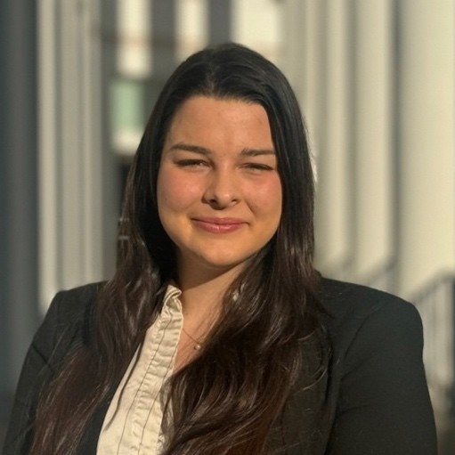

There is an old Chinese saying: “No one who rises before dawn 360 days a year fails to make his family rich.”

We read it carefully. We thought about it deeply. And then we went back to sleep. 

Our team believes in a slightly updated version: why wake up before dawn to get rich, when you can let compound interest do the work while you sleep? That leaves 5 spare days a year for sunrises, and we are still deciding whether to use them.

So we are not against success. We just schedule it for after 10 a.m.

::: {.team}

::: {.member}
{.headshot}

### Emma K. Adams
The American 
:::

::: {.member}
{.headshot}

### Marc Friedrich von Haas
The German
:::

:::